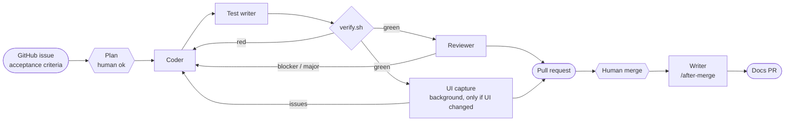

# Vadem

An iOS app that tracks credit card installments and subscriptions and answers one question: **how much do I pay this month?**

No bank connection. Data is entered by the user and never leaves the device.

This repository is also an experiment in **developing with an AI agent team**. Agents write the code and the tests. Scripts decide whether it passes. A human sets the rules and merges.

> **Rules are set by a human, code is written by agents, and merging is done by a human.**

## Status

Phase 17 (simple add flow) is built: Home's Add button opens a full-height sheet with Installment, Subscription and Payment, and all three kinds are added as quick steps (installment: amount, count, card, first month, optional title; subscription: amount, period, card, optional title; payment: amount, date, card, optional title; each ends with a summary and one Save). One-time payments are stored (schema V3), shown across the app (Home, Analytics, reminders, assistant, widget, Siri), and can be edited and deleted by tapping their row on Home. Issues #187 to #192 are done. Phase 16 (polish) is in progress: the app has an icon (light, dark and tinted, generated by `tools/make-icon.swift`), app and build versions are set in one place (`Config/Shared.xcconfig`), and the App Store listing text is in [`docs/app-store.md`](docs/app-store.md); the app and widget have privacy manifests and a privacy policy text is in [`docs/privacy.md`](docs/privacy.md) (English and Turkish) and is also shown in the app from a Settings row; a second accessibility pass fixed form choice row labels, the Analytics legend contrast and truncated form titles (VoiceOver not yet tried on a device); an accessibility pass added VoiceOver fixes to Analytics (chart summary with total and highest month, adjustable month selection), the Home calendar ("Today" value) and the Assistant (answers are announced); the app, widget and Siri phrases are translated to Turkish (all four String Catalogs have a `tr` value for every key). Phase 15 (assistant) is in progress: `VademCore` has read-only assistant queries (month total, payments, next payment, a card's total, debt-free month) and `PromptSafeText` for cleaning user text before it reaches a model, an on-device model engine exists for iOS 26, and Home's sparkles button opens an assistant chat screen (iOS 26 and later, with suggestion chips and an explanation screen when the model is unavailable). Phase 14 (charts) is in progress: Home's toolbar has a chart button that opens an Analytics screen with a bar chart of the next 12 months, split into installments and subscriptions; selecting a bar shows that month by card in a donut with a legend and a "last installment payment" insight. Phase 13 (widget and Siri) is built: a home-screen widget (small, medium and lock-screen sizes) shows the month total and the next payments, and a pure `PaymentSummary` (month total, amount remaining, next payments, spoken sentences) is in `VademCore`, and Siri and Shortcuts can answer "monthly total" and "next payment" through App Intents (English sentences, Turkish amounts); the widget needs the App Group enabled for its bundle id to run on a device. Phase 12 (notifications) is done: the reminder planner and scheduling are in (reminders are scheduled on the device, and the notification permission is asked once after the first payment is saved), and a Settings sheet (gear button on Home) turns reminders on or off and picks the timing; Phase 11 (forms) is done. The pipeline is complete; features go through it. Domain so far: `Money`, `YearMonth`, `InstallmentPlan`, `Subscription`, `Card`, `InstallmentItem`, `SubscriptionItem`, the `PaymentRepository` storage contract, `MonthlySchedule` (what is due in a month, with totals) and `NotificationPlanner` (which reminders to schedule). Persistence (Phase 9) is done: payments are stored on device with SwiftData. The design system (theme, card faces, amounts) is in; its card text contrast and navigation bar fixes ([#36](https://github.com/alicankurt1/Vadem-iOS/issues/36)) come next, then the rest of the home screen. Home has a strip of the next 6 months with totals; tapping a month selects it. Below it, a month calendar shows each day's total; tapping a day filters the list to that day. Home shows the app name as its navigation bar title (the version is in Settings) and starts with a hero panel showing the month's total and how much of it is already due; its "Add" button opens a form to add an installment plan (the card is optional; without one you pick a payment day), with validation, and its "Calendar" button jumps to the calendar; cards are added from a separate form (from the installment form or from a prompt on Home when no card exists). The add and edit forms use the same card look as Home, and so do the upcoming months strip and the calendar (the design refresh is complete). Tapping a payment row or card subtotal on Home opens it for editing, and the edit screen can delete it (a card that still has payments cannot be deleted). Settings has a Cards screen that lists all cards and opens the same add and edit forms.

## The pipeline

One command per issue: `/ship #N`.



| Role | Defined in | Can change | Decides |
|---|---|---|---|
| Orchestrator | [`/ship`](.claude/skills/ship/SKILL.md) (main session) | Branches, PR, metrics | What runs next; when to stop and ask |
| Coder | [`coder.md`](.claude/agents/coder.md) | Production code only | — |
| Test writer | [`test-writer.md`](.claude/agents/test-writer.md) | Tests only, from acceptance criteria | — |
| Verify | [`scripts/verify.sh`](scripts/verify.sh) (not an agent) | Nothing | **Pass / fail** (`swift test` + build) |
| Reviewer | [`reviewer.md`](.claude/agents/reviewer.md) | Nothing (read-only tools) | Findings by severity, with `file:line` |
| UI capture | [`scripts/ui-check.sh`](scripts/ui-check.sh), run by the orchestrator in the background (the [`ui-checker.md`](.claude/agents/ui-checker.md) agent is off) | Nothing | Accessibility audit failures on light / dark / AX5 screenshots; screenshots are opened only when a line needs it |
| Writer | [`writer.md`](.claude/agents/writer.md) via [`/after-merge`](.claude/skills/after-merge/SKILL.md) | `CHANGELOG.md`, `README.md`, `NOTES.md` | — |

### Principles

- **Agents write tests; a script runs them.** No agent can say "tests pass". Only `VERIFY: PASS` from the current tree counts.
- **Independence.** The test writer and the reviewer get the issue and the diff, never the coder's reasoning. Otherwise they would share its blind spots.
- **Roles are enforced by tools where possible.** The reviewer has no edit tools.
- **Bounded loops.** At most 3 red-verify rounds and 2 review rounds. After that, the orchestrator stops and asks.
- **The factory is not built by the product line.** Agents never change `scripts/`, `.claude/` or the harness. Harness bugs found during a run get their own PR, reviewed by a human.
- **Merging is always human.**

### What the gates caught

- **#7 `YearMonth`:** green tests, but the reviewer found that `9999-12 + 1 month` encoded to a string that could not be decoded, and that huge years overflowed. The acceptance criteria had no year limit, so the tests could not see it.
- **#10 version label:** the accessibility audit flagged an unreadable label and then clipped text. The UI check agent then found that **the harness itself was broken**: dark mode was never applied (identical screenshots), and only the first failure per test was reported. The harness was fixed in its own PR (#11) before the product fix continued.
- **#15 `InstallmentPlan`:** the reviewer found a crash path for plans ending after year 9999, and invalid JSON plans that were never tested for rejection.

### Metrics

One row per pipeline run, from [`metrics/runs.jsonl`](metrics/runs.jsonl) (`scripts/metrics-report.sh --update-readme`). Findings are blocker / major / minor / nit; "—" means the step did not exist yet or was skipped.

<!-- metrics:start -->
| Issue | PR | Minutes | Verify runs (red) | Fix rounds | Review B / M / m / n | UI check B / M / m / n |
|---|---|---|---|---|---|---|
| #4 | #5 | 2 | 3 (0) | 0 | — | — |
| #7 | #8 | 8 | 8 (0) | 1 | 0 / 0 / 2 / 2 | — |
| #10 | #12 | 29 | 11 (0) | 3 | 0 / 1 / 2 / 3 | 0 / 5 / 1 / 2 |
| #15 | #16 | 32 | 7 (0) | 1 | 0 / 0 / 2 / 4 | — |
| #19 | #20 | 5 | 4 (0) | 0 | 0 / 0 / 0 / 2 | — |
| #23 | #24 | 5 | 4 (0) | 0 | 0 / 0 / 0 / 2 | — |
| #26 | #27 | 11 | 8 (0) | 1 | 0 / 0 / 3 / 1 | — |
| #30 | #31 | 15 | 7 (0) | 1 | 0 / 0 / 1 / 2 | — |
| #33 | #38 | 131 | 12 (0) | 3 | 0 / 2 / 3 / 5 | 1 / 9 / 4 / 2 |
| #36 | #40 | 83 | 7 (0) | 2 | 0 / 0 / 2 / 4 | 0 / 1 / 0 / 0 |
| #42 | #43 | 9 | 7 (0) | 1 | 0 / 0 / 2 / 4 | — |
| #45 | #46 | 13 | 11 (0) | 2 | 0 / 1 / 5 / 1 | 0 / 1 / 0 / 0 |
| #50 | #51 | 10 | 3 (0) | 0 | 0 / 0 / 3 / 1 | 0 / 0 / 0 / 0 |
| #53 | #55 | 116 | 6 (0) | 1 | 0 / 0 / 2 / 2 | 0 / 2 / 0 / 0 |
| #59 | #60 | 118 | 2 (0) | 0 | 0 / 0 / 0 / 0 | — |
| #62 | #63 | 90 | 12 (1) | 3 | 0 / 1 / 4 / 6 | 0 / 2 / 0 / 0 |
| #65 | #68 | 37 | 2 (0) | 1 | 0 / 0 / 4 / 3 | 0 / 3 / 0 / 0 |
| #66 | #70 | 33 | 6 (0) | 1 | 0 / 0 / 1 / 2 | 0 / 2 / 0 / 0 |
| #67 | #74 | 150 | 11 (0) | 3 | 0 / 0 / 5 / 2 | 0 / 3 / 0 / 0 |
| **19 runs** | | **897** | **131 (1)** | **24** | **0 / 5 / 41 / 46** | **1 / 28 / 5 / 4** |
<!-- metrics:end -->

## Using it

Requirements: Xcode 26+, [Claude Code](https://code.claude.com/docs), [GitHub CLI](https://cli.github.com) (`gh auth login`).

```bash
cp Config/Local.xcconfig.example Config/Local.xcconfig   # set your DEVELOPMENT_TEAM
open Vadem.xcodeproj
```

| Command | What it does |
|---|---|
| `/ship #N` | Whole pipeline for issue N. It waits once, for your "ok" on the plan, and ends with a PR. |
| `/after-merge #P` | After you merge PR P, the writer updates the docs in a small docs PR. |
| `/verify` or `scripts/verify.sh` | Package unit tests + app build, no simulator (seconds). |
| `scripts/ui-check.sh` | Simulator screenshots (light / dark / largest text) + accessibility audit (the full gallery takes about 18 min with the three variants run in parallel). `UI_CHECK_ONLY=gallery,root` captures only those screens. |
| `scripts/appstore-screenshots.sh` | App Store screenshots (Home, Add installment, Analytics, Cards) per device and language into `AppStoreScreenshots/` (git-ignored). `APPSTORE_DEVICES` and `APPSTORE_LANGUAGES` select devices and languages (default iPhone 17 Pro Max, `en` and `tr`); about 75-107 s for the default. |

Write issues with the [task template](.github/ISSUE_TEMPLATE/task.md). Its acceptance criteria are the contract for every agent.

## The app

- SwiftUI, Observation, MVVM. Swift 6 with strict concurrency, iOS 18+, newer APIs behind `@available`.
- Local Swift package [`Packages/VademKit`](Packages/VademKit). `VademCore` is the pure domain, tested with `swift test`, and has no UI imports. `VademPersistence` is the only module that imports SwiftData (versioned schema, App Group store). `VademFeatures` holds the screens and the design system (theme "Ink and Vade": teal color tokens for light and dark, mesh card faces, Turkish lira amounts, and the hero panel, payment row and surface card components, used by Home and the forms).
- Money is `Decimal`, never `Double`. Installment rounding is decided in ADR-0001 ([#15](https://github.com/alicankurt1/Vadem-iOS/issues/15)).
- Swift Testing for unit tests, XCUITest for UI capture. No third-party dependencies.
- Roadmap: [PLAN.md](PLAN.md) · Changes: [CHANGELOG.md](CHANGELOG.md).

## License

TBD
