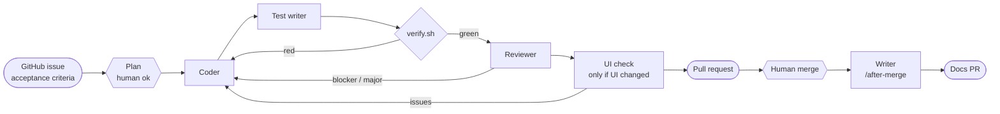

# Vadem

An iOS app that tracks credit card installments and subscriptions and answers one question: **how much do I pay this month?**

No bank connection. Data is entered by the user and never leaves the device.

This repository is also an experiment in **developing with an AI agent team**. Agents write the code and the tests. Scripts decide whether it passes. A human sets the rules and merges.

> **Rules are set by a human, code is written by agents, and merging is done by a human.**

## Status

🚧 Phase 10 — in progress. The pipeline is complete; features go through it. Domain so far: `Money`, `YearMonth`, `InstallmentPlan`, `Subscription`, `Card`, `InstallmentItem`, `SubscriptionItem`, and the `PaymentRepository` storage contract. Persistence (Phase 9) is done: payments are stored on device with SwiftData. The design system (theme, card faces, amounts) is in; its card text contrast and navigation bar fixes ([#36](https://github.com/alicankurt1/Vadem-iOS/issues/36)) come next, then the home screen.

## The pipeline

One command per issue: `/ship #N`.



| Role | Defined in | Can change | Decides |
|---|---|---|---|
| Orchestrator | [`/ship`](.claude/skills/ship/SKILL.md) (main session) | Branches, PR, metrics | What runs next; when to stop and ask |
| Coder | [`coder.md`](.claude/agents/coder.md) | Production code only | — |
| Test writer | [`test-writer.md`](.claude/agents/test-writer.md) | Tests only, from acceptance criteria | — |
| Verify | [`scripts/verify.sh`](scripts/verify.sh) (not an agent) | Nothing | **Pass / fail** (`swift test` + build) |
| Reviewer | [`reviewer.md`](.claude/agents/reviewer.md) | Nothing (read-only tools) | Findings by severity, with `file:line` |
| UI check | [`ui-checker.md`](.claude/agents/ui-checker.md) + [`scripts/ui-check.sh`](scripts/ui-check.sh) | Nothing | Visual findings from light / dark / AX5 screenshots + Apple's accessibility audit |
| Writer | [`writer.md`](.claude/agents/writer.md) via [`/after-merge`](.claude/skills/after-merge/SKILL.md) | `CHANGELOG.md`, `README.md`, `NOTES.md` | — |

### Principles

- **Agents write tests; a script runs them.** No agent can say "tests pass". Only `VERIFY: PASS` from the current tree counts.
- **Independence.** The test writer and the reviewer get the issue and the diff, never the coder's reasoning. Otherwise they would share its blind spots.
- **Roles are enforced by tools where possible.** The reviewer and UI checker have no edit tools.
- **Bounded loops.** At most 3 red-verify rounds and 2 review rounds. After that, the orchestrator stops and asks.
- **The factory is not built by the product line.** Agents never change `scripts/`, `.claude/` or the harness. Harness bugs found during a run get their own PR, reviewed by a human.
- **Merging is always human.**

### What the gates caught

- **#7 `YearMonth`:** green tests, but the reviewer found that `9999-12 + 1 month` encoded to a string that could not be decoded, and that huge years overflowed. The acceptance criteria had no year limit, so the tests could not see it.
- **#10 version label:** the accessibility audit flagged an unreadable label and then clipped text. The UI check agent then found that **the harness itself was broken**: dark mode was never applied (identical screenshots), and only the first failure per test was reported. The harness was fixed in its own PR (#11) before the product fix continued.
- **#15 `InstallmentPlan`:** the reviewer found a crash path for plans ending after year 9999, and invalid JSON plans that were never tested for rejection.

### Metrics

One row per pipeline run, from [`metrics/runs.jsonl`](metrics/runs.jsonl) (`scripts/metrics-report.sh --update-readme`). Findings are blocker / major / minor / nit; "—" means the step did not exist yet or was skipped.

<!-- metrics:start -->
| Issue | PR | Minutes | Verify runs (red) | Fix rounds | Review B / M / m / n | UI check B / M / m / n |
|---|---|---|---|---|---|---|
| #4 | #5 | 2 | 3 (0) | 0 | — | — |
| #7 | #8 | 8 | 8 (0) | 1 | 0 / 0 / 2 / 2 | — |
| #10 | #12 | 29 | 11 (0) | 3 | 0 / 1 / 2 / 3 | 0 / 5 / 1 / 2 |
| #15 | #16 | 32 | 7 (0) | 1 | 0 / 0 / 2 / 4 | — |
| #19 | #20 | 5 | 4 (0) | 0 | 0 / 0 / 0 / 2 | — |
| #23 | #24 | 5 | 4 (0) | 0 | 0 / 0 / 0 / 2 | — |
| #26 | #27 | 11 | 8 (0) | 1 | 0 / 0 / 3 / 1 | — |
| #30 | #31 | 15 | 7 (0) | 1 | 0 / 0 / 1 / 2 | — |
| #33 | #38 | 131 | 12 (0) | 3 | 0 / 2 / 3 / 5 | 1 / 9 / 4 / 2 |
| **9 runs** | | **238** | **64 (0)** | **10** | **0 / 3 / 13 / 21** | **1 / 14 / 5 / 4** |
<!-- metrics:end -->

## Using it

Requirements: Xcode 26+, [Claude Code](https://code.claude.com/docs), [GitHub CLI](https://cli.github.com) (`gh auth login`).

```bash
cp Config/Local.xcconfig.example Config/Local.xcconfig   # set your DEVELOPMENT_TEAM
open Vadem.xcodeproj
```

| Command | What it does |
|---|---|
| `/ship #N` | Whole pipeline for issue N. It waits once, for your "ok" on the plan, and ends with a PR. |
| `/after-merge #P` | After you merge PR P, the writer updates the docs in a small docs PR. |
| `/verify` or `scripts/verify.sh` | Package unit tests + app build, no simulator (seconds). |
| `scripts/ui-check.sh` | Simulator screenshots (light / dark / largest text) + accessibility audit (~1 min). |

Write issues with the [task template](.github/ISSUE_TEMPLATE/task.md). Its acceptance criteria are the contract for every agent.

## The app

- SwiftUI, Observation, MVVM. Swift 6 with strict concurrency, iOS 18+, newer APIs behind `@available`.
- Local Swift package [`Packages/VademKit`](Packages/VademKit). `VademCore` is the pure domain, tested with `swift test`, and has no UI imports. `VademPersistence` is the only module that imports SwiftData (versioned schema, App Group store). `VademFeatures` holds the screens and the design system (theme "Ink and Vade": color tokens for light and dark, mesh card faces, Turkish lira amounts).
- Money is `Decimal`, never `Double`. Installment rounding is decided in ADR-0001 ([#15](https://github.com/alicankurt1/Vadem-iOS/issues/15)).
- Swift Testing for unit tests, XCUITest for UI capture. No third-party dependencies.
- Roadmap: [PLAN.md](PLAN.md) · Changes: [CHANGELOG.md](CHANGELOG.md).

## License

TBD
